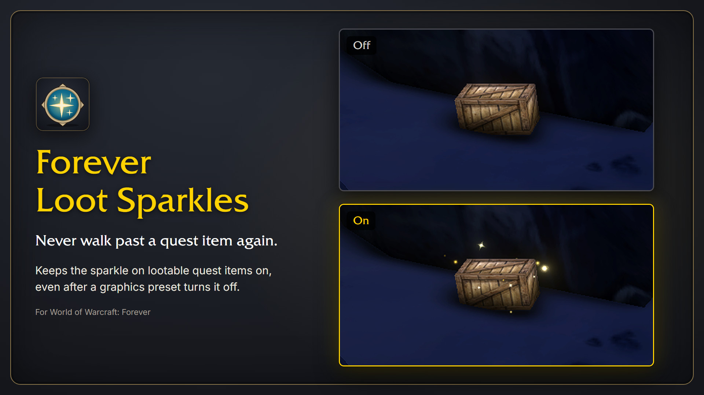
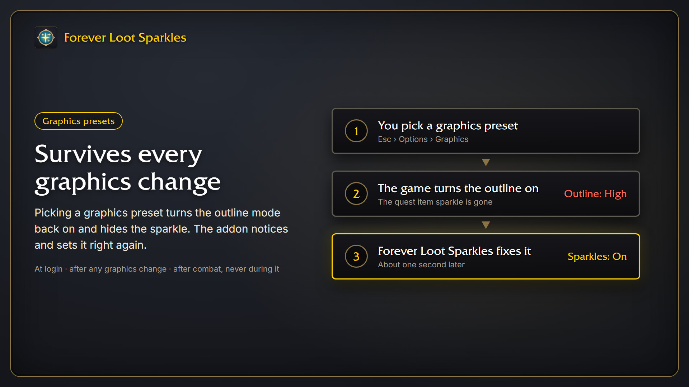

# Forever Loot Sparkles


A small addon for **World of Warcraft: Forever** that keeps the game's loot sparkle on quest items switched on, so you never walk past them.

Graphics presets switch the loot sparkle off. The addon switches it back on at login, and again about a second after any graphics change resets it. Your outline mode, and with it the Self Highlight outline around your character, is left as you set it. During combat it waits until the fight is over.

No slash commands, nothing to set up.





## Options

Open **Esc > Options > AddOns > Forever Loot Sparkles**.

| Checkbox | Default | What it does |
| --- | --- | --- |
| Show quest item sparkles | on | Keeps the loot sparkle on. |

Switching it on works at once. Switching it off only takes effect after **restarting the game** (`/reload` is not enough). A reminder appears in chat.

## Install

1. Download the latest release zip, or install it with the CurseForge app.
2. Extract it so you have `World of Warcraft\_forever_\Interface\AddOns\ForeverLootSparkles`.
3. Restart the game or type `/reload`.

## Where did the herb, ore and corpse sparkles go?

Versions 1.2.0 to 1.3.1 also made ore veins, herbs, corpses with loot and quest objects sparkle. That relied on Blizzard's soft targeting, and it caused trouble: friendly spells cast without a target landed on someone nearby instead of on you, dead mobs showed an empty nameplate, and interact icons appeared above objects. Version 2.0.0 removes all of it.

**Looking for herb and ore sparkles?** There are two addons for that:

- [Forever Loot Sparkles : Herbs & Ores](https://www.curseforge.com/wow/addons/forever-loot-sparkles-herbs-ores) by N3zr0k is a small companion addon for this one. It brings back the sparkles on herbs, ore veins, quest objects and corpses with loot, with a color of your own for each, and comes with its own fixes for the self-cast, nameplate and interact icon problems. It needs Forever Loot Sparkles installed.
- [Lueur](https://www.curseforge.com/wow/addons/lueur) is the bigger one. It lights up ore veins, herbs, chests and quest objects as you approach them, with ten effects to choose from (sparkles and a light beam among them).

On the first login after updating, the addon puts the soft targeting settings it changed back to what you had before: **Enable Interact Key**, the interact icons on objects, the interact range and the soft target nameplate. If you changed one of them yourself in the meantime, yours stays.

If you still see an icon above objects or friendly spells still don't land on you, check these yourself:

- **Enable Interact Key** in the game's Options: switch it off, or type `/console SoftTargetInteract 0`.
- **Options > Accessibility > Interact Key Icons**: pick "Default".

## Turning it off again

The easiest way is the checkbox under Options (see above). Untick it, restart the game, then disable the addon.

Uninstalling or disabling the addon does **not** undo the setting, because WoW saves console variables in its own config file, not in the addon's folder. If you removed the addon while the sparkles were on, either pick a graphics preset again, or type:

```
/console outlineModeShowLootEffectWhenDisabled 0
```

Then restart the game (`/reload` is not enough).

Deleting the `WTF` or `Interface` folder may not help either: WoW keeps a copy of many settings on Blizzard's servers and brings them back at the next login. The command above changes that copy too.

## FAQ

**Can I have the sparkle and the outline at the same time?**
No. The game has one switch for this: the loot sparkle replaces the outline on quest items. This addon only keeps the game's own effect on; for other effects, such as a light beam on nearby objects, see [Lueur](https://www.curseforge.com/wow/addons/lueur).

**Quest givers or other NPCs sparkle too.**
Since 2.0.0 the only sparkle left is the game's own loot sparkle, which the addon keeps switched on. The game decides which objects get it; addons can't pick. If you have the companion addon [Forever Loot Sparkles : Herbs & Ores](https://www.curseforge.com/wow/addons/forever-loot-sparkles-herbs-ores) installed, its sparkles are set on its own options.

**I see 2 or 3 minimap icons for one herb.**
That doesn't come from this addon, which never touches the minimap. Try with only this addon enabled; if it still happens, it is the game or another addon.

## What it sets

| Console variable | Value |
| --- | --- |
| `outlineModeShowLootEffectWhenDisabled` | 1 |

Versions up to 1.3.0 also switched the outline mode off. If you want it back, pick it under Options > Graphics (Outline Mode), or type `/console graphicsOutlineMode 2`.

## Support

The addon is free and always will be. If it made your game a bit nicer, you can [buy me a coffee](https://buymeacoffee.com/conoar) or send something via [PayPal](https://paypal.me/svengabr).
